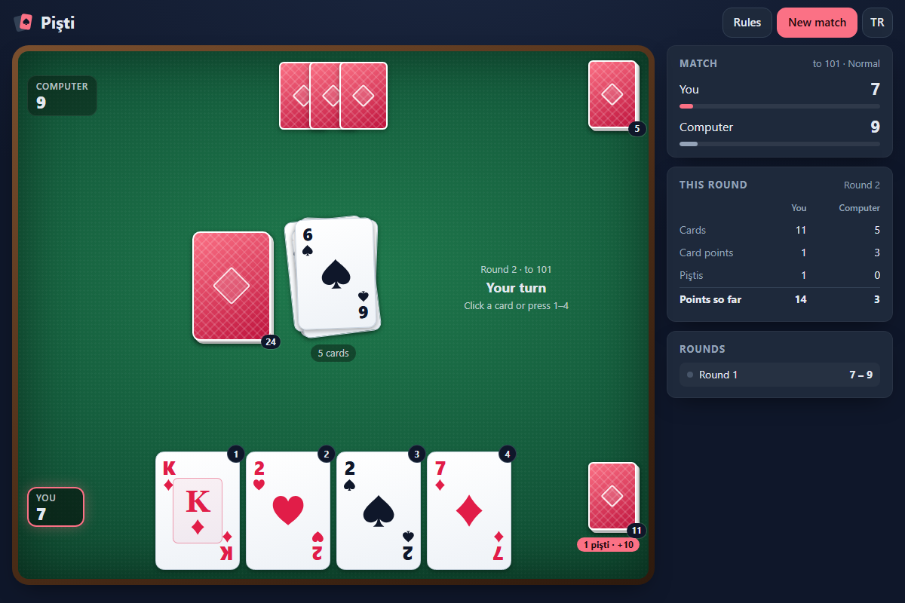

# Pişti - the classic Turkish card game, in your browser against the computer

[](#tests)
[](LICENSE)

**▶ Play now: https://celaldrg.github.io/pisti/**



## Features

- Two-player Pişti against the computer, with the full rules: the opening Jack rule, captures with a matching rank or a Jack, piştis worth 10 points (20 for a Jack on a lone Jack) and the last take.
- Complete scoring: Jacks, Aces, 2 of clubs, 10 of diamonds, 3 points for the most cards, plus piştis. A summary after every round shows the breakdown.
- Matches to 51, 101 or 151 points. Two computer levels: Easy, and Normal, which remembers the cards played.
- A score panel with the match score, a running tally of the round and the finished rounds.
- Cards drawn with CSS and SVG on a green felt table, with deal, play and capture animations and a "Pişti!" burst. Honours reduced motion.
- English and Turkish. The language switch changes every text on the page and is remembered.
- Mobile first: plays with touch on a 375 px wide phone and with the keyboard on desktop.
- No build step, no dependencies, no tracking: plain HTML, CSS and JavaScript modules.

## How to play

Four cards go on the table with only the top one face up, and each player gets four cards. Take turns playing one card onto the pile:

- A card of the same rank as the top card takes the whole pile. A Jack takes the pile whatever is on top.
- Taking a pile of exactly one card with the same rank is a **pişti**: 10 points, or 20 for a Jack on a lone Jack.
- When both hands are empty, four more cards each are dealt until the deck runs out. Whoever took a pile last also takes the cards left on the table.
- After each round, points are counted: 1 for each Jack and Ace, 2 for the 2 of clubs, 3 for the 10 of diamonds, 3 for the most cards, plus the piştis. The first to reach the target wins the match.

Controls:

- **Touch or mouse:** tap or click a card in your hand to play it.
- **Keyboard:** keys 1–4 play the card in that position. Tab moves between the cards and Enter or Space plays the focused one. Esc closes a dialog.
- **Buttons:** New match (target score and computer level), Rules, and TR / EN to switch the language.

Add `?demo` to the address for a fixed position in the middle of a round (it is used for the screenshot).

## Run locally

The game uses ES modules, so it must be served over `http://`. Opening `index.html` straight from the disk does not work.

```bash
npx serve .
```

Then open the address it prints, for example http://localhost:3000.

## Tests

```bash
node --test
```

You need Node 22 or newer and nothing to install. The tests cover the rules, the scoring, the computer player, 1000 seeded games of one round each played to the last card (card conservation, the 13 card points, piştis, the last take), whole matches to the target score, the demo position, the view model the animations replay, the translations, the settings and the storage.

## Project structure

```
index.html          the page, its dialogs and the suit symbols
style.css           theme, felt table, cards, animations and layout
src/
  cards.js          the deck, card points and the seeded shuffle
  rng.js            seeded random numbers
  rules.js          one round: opening, deals, captures, piştis, last take
  scoring.js        round scoring
  match.js          a match: rounds, dealer, target and winner
  ai.js             the computer player (Easy, Normal)
  game.js           the controller the page talks to (no DOM)
  demo.js           the ?demo position
  table-model.js    the table view, rebuilt one game event at a time
  i18n.js           English and Turkish texts, card names and rules
  settings.js       saved preferences, checked on load
  storage.js        the only localStorage access, always guarded
  main.js           entry point: match flow, input and language
  table-view.js     draws the hands, deck, pile and capture piles
  animate.js        deal, play, capture and pişti animations
  fx.js             card flights, the pişti burst and toasts
  cardview.js       card faces and backs
  panel.js          the score panel
  dialogs.js        round summary, rules and new match dialogs
  dom.js            small DOM helpers
test/               node:test suites
docs/screenshot.png
```

The game logic in `src/` is pure: no DOM, no storage and all randomness from a seeded generator, so every game can be replayed and tested in Node.

## License

[MIT](LICENSE) © 2026 Celalettin Durgaç

## Türkçe

Pişti: klasik Türk kart oyunu, tarayıcıda bilgisayara karşı.

**▶ Hemen oyna: https://celaldrg.github.io/pisti/**

### Özellikler

- Bilgisayara karşı iki kişilik pişti, kuralların tamamıyla: açılışta vale kuralı, aynı değerde kartla ya da valeyle alma, 10 puanlık pişti (tek valenin üstüne vale 20) ve yerde kalanları son alanın toplaması.
- Eksiksiz puanlama: valeler, aslar, sinek ikilisi, karo onlusu, en çok kart için 3 puan ve piştiler. Her elin sonunda puan dökümü gösterilir.
- 51, 101 ya da 151 puanlık oyunlar. İki bilgisayar seviyesi: Kolay ve atılan kartları aklında tutan Normal.
- Oyun skorunu, süren elin anlık puanlarını ve biten elleri gösteren skor paneli.
- Yeşil çuha masa ve CSS ile SVG'den çizilmiş kartlar; dağıtma, oynama ve alma animasyonları, "Pişti!" patlaması. Azaltılmış hareket ayarına uyar.
- Türkçe ve İngilizce. Dil düğmesi sayfadaki bütün yazıları değiştirir ve seçim hatırlanır.
- Önce mobil: 375 px genişliğindeki telefonda dokunarak, masaüstünde klavyeyle oynanır.
- Derleme adımı, bağımlılık ve izleme yok: yalnız HTML, CSS ve JavaScript modülleri.

### Nasıl oynanır

Yere dört kart konur, yalnız en üstteki açıktır; her oyuncuya dört kart verilir. Sırayla yere birer kart atılır:

- Yerdeki en üst kartla aynı değerde kart atan bütün kartları alır. Vale, üstte ne olursa olsun bütün kartları alır.
- Yerde tek kart varken onu aynı değerde kartla almak **pişti**dir: 10 puan, tek valenin üstüne vale 20 puan.
- İki elde de kart kalmayınca deste bitene kadar dörder kart daha dağıtılır. Kartlar bitince yerde kalanları en son kart alan toplar.
- Her elin sonunda puanlar sayılır: her vale ve as 1, sinek ikilisi 2, karo onlusu 3, en çok kart 3 puan, üstüne piştiler. Hedef puana ilk ulaşan oyunu kazanır.

Kontroller:

- **Dokunma ya da fare:** oynamak için elindeki bir karta dokun ya da tıkla.
- **Klavye:** 1–4 tuşları o sıradaki kartı oynar. Tab kartlar arasında gezer, Enter ya da Boşluk seçili kartı oynar. Esc pencereyi kapatır.
- **Düğmeler:** Yeni oyun (hedef puan ve bilgisayar seviyesi), Kurallar ve dili değiştiren TR / EN.

Adresin sonuna `?demo` eklersen bir elin ortasında sabit bir durum açılır (ekran görüntüsü bununla alınır).

### Yerelde çalıştırma

Oyun ES modülleri kullandığı için `http://` üzerinden sunulmalı; `index.html` dosyasını doğrudan diskten açmak çalışmaz.

```bash
npx serve .
```

Sonra yazdığı adresi aç, örneğin http://localhost:3000.

### Testler

```bash
node --test
```

Node 22 ya da daha yenisi yeter, kurulacak bir şey yok. Testler kuralları, puanlamayı, bilgisayar oyuncusunu, son karta kadar oynanan 1000 tohumlu tek eli (kart korunumu, 13 kart puanı, piştiler, son alış), hedef puana kadar oynanan tam oyunları, demo durumunu, animasyonların izlediği masa modelini, çevirileri, ayarları ve depolamayı kapsar.

### Lisans

[MIT](LICENSE) © 2026 Celalettin Durgaç
